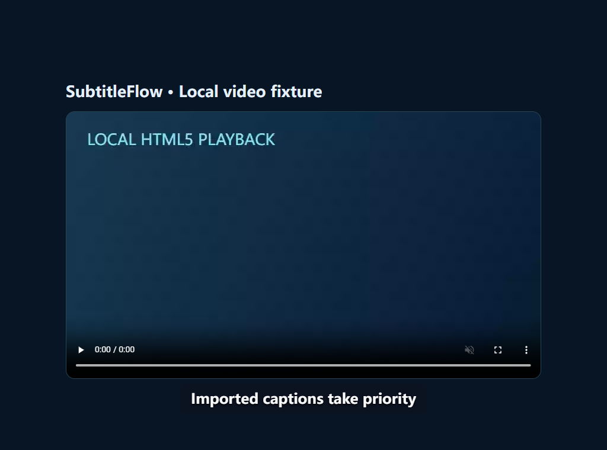

# SubtitleFlow

[](https://github.com/yuchen0x1/SubtitleFlow/actions/workflows/ci.yml)
[](https://github.com/yuchen0x1/SubtitleFlow/releases/latest)

SubtitleFlow 是 Chrome 与 Edge 桌面浏览器的视频字幕扩展。它读取可访问的网页字幕或本地字幕文件，并按播放器时间显示。需要从声音生成字幕或自动翻译时，可以单独配置服务。

## 最新更新

<!-- github-release:start -->

### v0.0.5 · 待发布

字幕可按 0.5 秒步进校准时间轴，也可从弹窗导出当前字幕为 SRT 或 WebVTT。弹窗和设置页跟随系统明暗主题。

v0.0.4 已公开发布，包含跨 Runner 的发布资产一致性修复。v0.0.3 仅对齐过源码版本元数据，未公开发布。

[全部发行记录](docs/releases/release-notes.md)

<!-- github-release:end -->

## 下载和安装

[下载最新发行包](https://github.com/yuchen0x1/SubtitleFlow/releases/latest) · [校验、安装、升级与回滚](docs/updating.md)

下载适用于 Chrome 和 Edge 的 Chromium ZIP，完成签名与 SHA-256 校验后解压。在浏览器的扩展管理页开启开发者模式并加载解压目录。随后刷新要观看的视频页。ZIP 使用手动更新，已上架的商店扩展才由浏览器自动更新。

## 开始使用

1. 打开网页视频，点击 SubtitleFlow 工具栏图标。
2. 默认选择「网页或文件」。有原生字幕时点击「显示字幕」。也可先导入文件，导入内容优先于网页字幕。结束后可移除文件，恢复网页字幕。
3. 字幕显示后，若时间不同步，可在弹窗按 0.5 秒提前或延后；当前字幕也可导出为 SRT 或 WebVTT。
4. 若要从声音识别，在设置中心配置 ASR，然后在弹窗主动选择「语音识别」。另配翻译服务可显示原文与译文。
5. 可在设置中心调整字幕大小、颜色和背景，也可拖动页面中的字幕层。



| 功能 | 桌面 Chrome | 桌面 Edge |
| --- | --- | --- |
| 原生网页字幕、SRT/VTT/ASS/SSA、仅原文 | 支持 | 支持 |
| 时间轴偏移、SRT / WebVTT 导出 | 支持 | 支持 |
| 可选 ASR、翻译、仅译文、双语 | Chromium 116+，取决于浏览器和服务权限 | 基于 Chromium，取决于浏览器和服务权限 |
| 发行和更新 | GitHub 通用 ZIP，手动重载 | GitHub 通用 ZIP，手动重载 |

参阅 [系统与浏览器支持范围](docs/platforms.md)、[测试结果](docs/testing.md) 和 [功能路线图](docs/research.md)。

## 可选本地服务

在 Windows 安装 Python 3.11 后运行 `npm run local-service`。在 macOS/Linux 可从仓库根目录执行：

```sh
python3.11 -m venv .venv
. .venv/bin/activate
python -m pip install -r apps/local-service/requirements.txt
python -m uvicorn app.main:app --app-dir apps/local-service --host 127.0.0.1 --port 8765
```

设置中心选择「本地 SubtitleFlow 服务」，填写 `http://127.0.0.1:8765`。首次识别通常需要下载模型，可先用 `tiny` 测试 CPU 路径。远端服务使用 HTTPS 或 WSS。自填 API Key 保存在浏览器本地。只有在使用相应服务时才向用户配置的服务发送字幕文本或音频。

## 常见问题

- 找不到字幕时，先打开播放器原生字幕或导入字幕文件。播放器可能不公开字幕轨。视频画面中烧录的字幕无法作为网页文本读取。
- 重载扩展后，刷新播放页以重新注入内容脚本。跨域 iframe、DRM 与浏览器保护页面可能限制检测或采集。
- 从声音识别需提供识别接口。OpenAI 兼容的聊天模型通常只负责翻译，与 `/audio/transcriptions` 的模型分开配置。

## 开发和贡献

使用 Node.js 24 与 Python 3.11。运行 `npm ci`、`npm run typecheck`、`npm run build`、`npm test` 和 `npm run pack:dist`。构建输出在 `dist/`，发包资产在 `artifacts/`。

核心由 TypeScript/React 弹窗和设置、MV3 后台与内容脚本、字幕时间轴，以及可选 Offscreen 音频和 Python 服务组成。参阅 [架构](docs/architecture.md)、[贡献指南](CONTRIBUTING.md) 和 [维护记录](docs/maintenance.md)。

项目使用 [MIT 许可证](LICENSE)。功能建议和兼容问题请 [发 Issue](https://github.com/yuchen0x1/SubtitleFlow/issues/new/choose)，漏洞请按 [安全报告说明](SECURITY.md) 私下提交。
